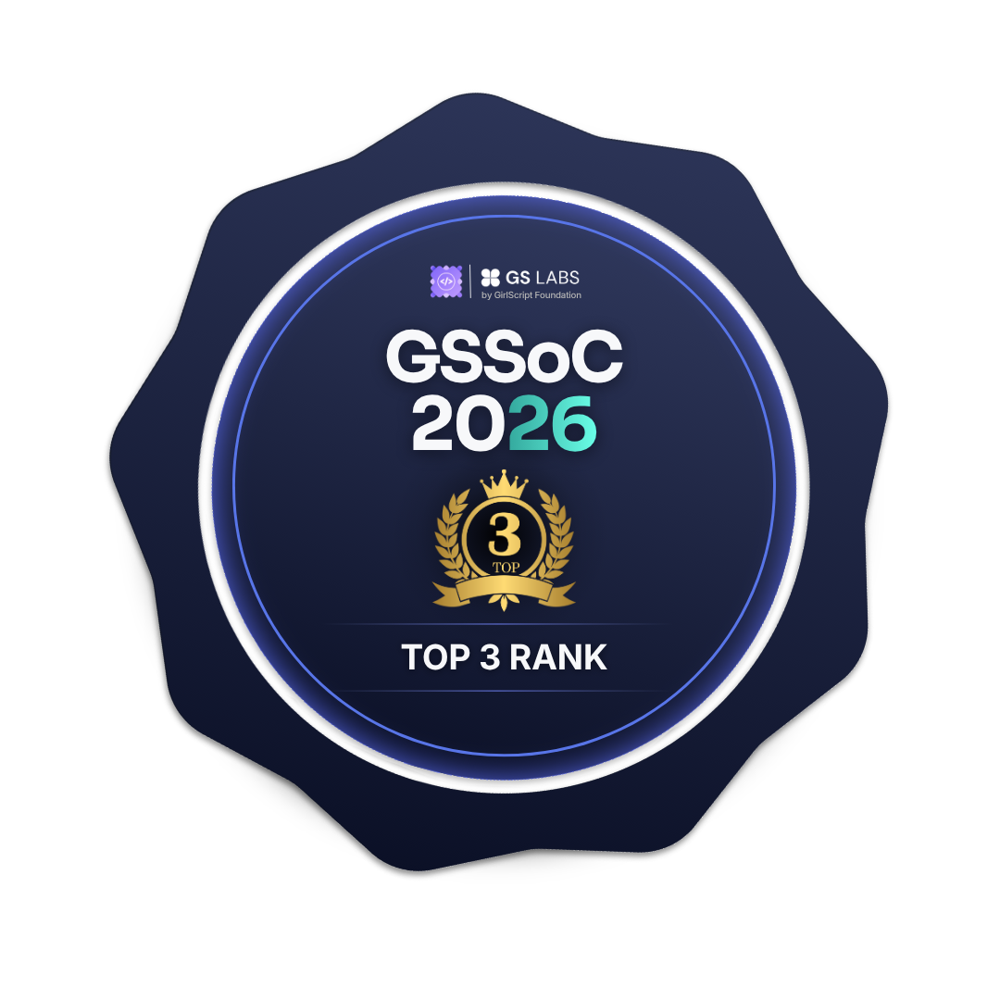
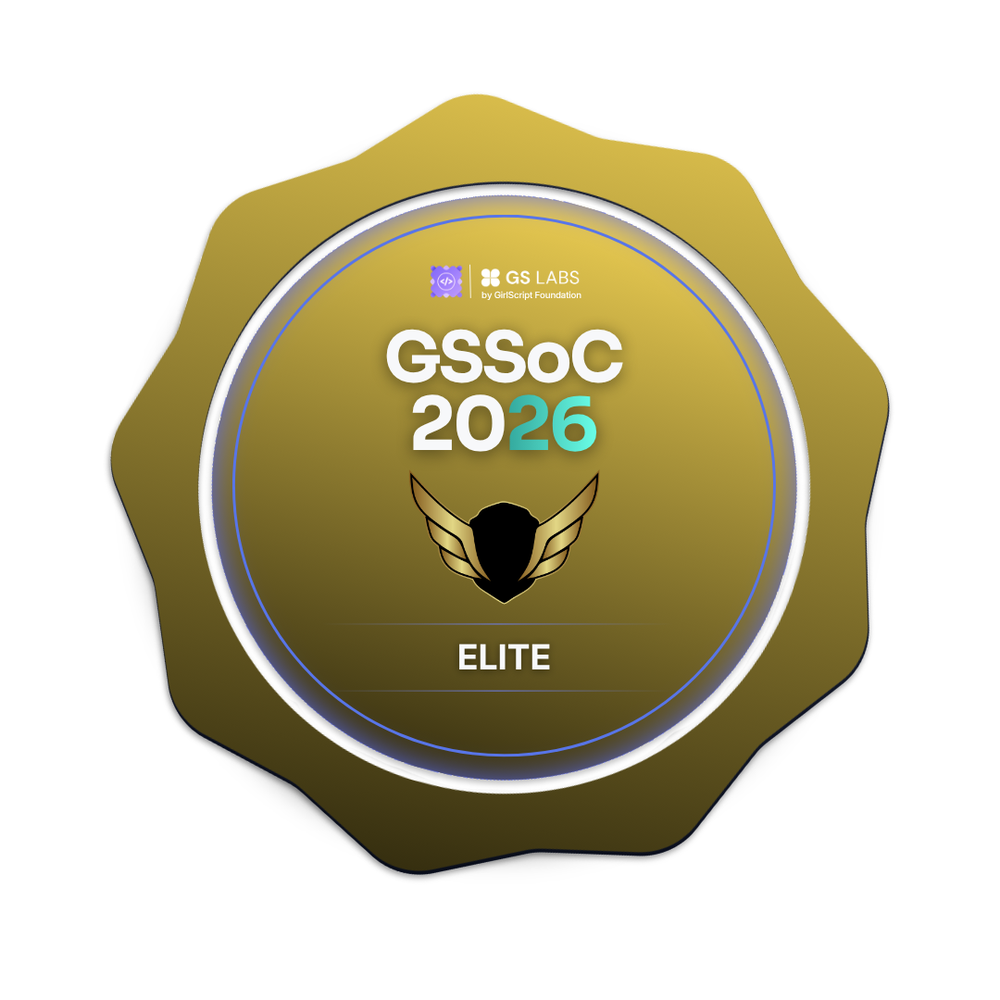
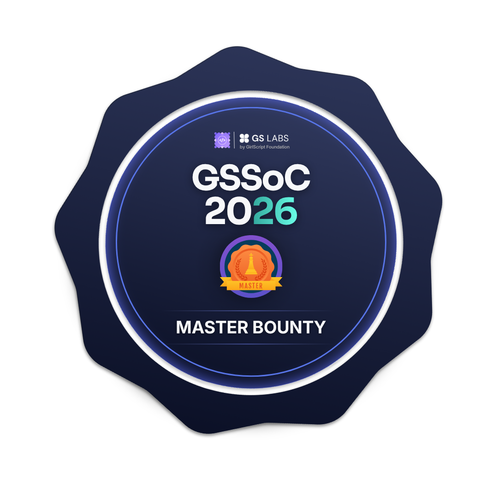
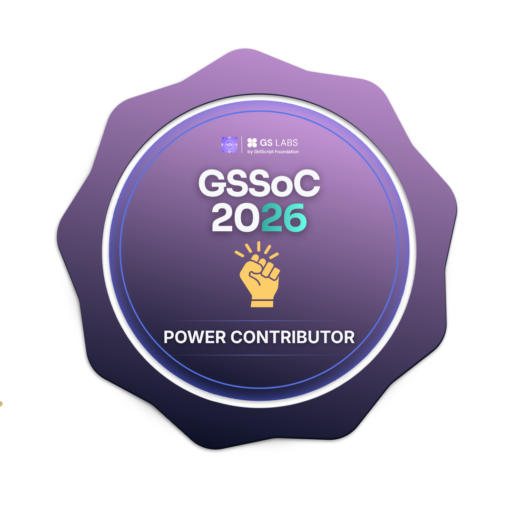

<!-- ========================================================================= -->
<!-- 🕷️ SPIDER_OS // ISSUE #001 // THE ENGINEER                                 -->
<!-- Satyam Pandey — AI & Systems Developer | CNCF OpenTelemetry Core Contributor -->
<!-- Portfolio: https://www.satyampandey.tech/                                 -->
<!-- ========================================================================= -->

<div align="center">

  <!-- Top Cyber Accent Border -->
  

  <br/><br/>

  <!-- Sexy Heading Banner: Monster // Johan Liebert — Psychological Masterpiece -->
  <a href="https://www.satyampandey.tech/">
    
  </a>

  <br/>

  <!-- Animated Header Capsule -->
  

  <!-- Dynamic Typing Mission Console -->
  

  <br/><br/>

  <!-- Quick Signal Badges -->
  <a href="https://satyampandey.tech/">
    
  </a>
  &nbsp;
  <a href="https://github.com/SatyamPandey-07">
    
  </a>
  &nbsp;
  <a href="https://github.com/SatyamPandey-07?tab=followers">
    
  </a>
  &nbsp;
  <a href="https://leetcode.com/u/Satyampandey1802/">
    
  </a>
  &nbsp;
  <a href="https://codeforces.com/profile/saam-pande">
    
  </a>
  &nbsp;
  <a href="https://github.com/open-telemetry/opentelemetry-go-compile-instrumentation">
    
  </a>

  <br/><br/>

  <!-- Tactical HUD Quick Links -->
  <code><b><a href="#-01--origin-story--spider-identity">01. ORIGIN</a></b></code> •
  <code><b><a href="#-02--performance-hud--direct-impact">02. PERFORMANCE HUD</a></b></code> •
  <code><b><a href="#-03--exhibits--flagship-case-files">03. CASE FILES</a></b></code> •
  <code><b><a href="#-04--field-reports--experience">04. FIELD REPORTS</a></b></code> •
  <code><b><a href="#-05--classified-clearances">05. CLEARANCES</a></b></code> •
  <code><b><a href="#-06--tactical-matrix--58-arsenal">06. ARSENAL</a></b></code> •
  <code><b><a href="#-07--global-grid--activity">07. GLOBAL GRID</a></b></code> •
  <code><b><a href="#-08--transmissions--connect">08. TRANSMISSIONS</a></b></code>

  <br/><br/>

  <!-- Bottom Accent Border -->
  

</div>

<br/>

> *“With great power comes great responsibility. In this digital multiverse, code is my web.”*  
> *“In the shadows, we build what the world relies on.”*

---

## 🕷️ 01 · Origin Story // Spider-Identity

```typescript
const satyamPandey: EngineerDossier = {
    identity: "Satyam Pandey",
    neuralLink: "10.0.0.1 // Active Protocol",
    edition: "Issue #001 — The Engineer (Noir / Spider_OS Mode)",
    location: "Mumbai, India 🇮🇳",
    
    academicRecord: {
        bachelorOfEngineering: {
            institution: "Thadomal Shahani Engineering College (TSEC '28)",
            specialization: "Artificial Intelligence & Data Science",
            cgpa: "8.90 / 10.0"
        },
        higherSecondaryCertificate: {
            institution: "Model College of Science & Commerce",
            score: "93.00% (Rank 1 Topper — Computer Science)"
        }
    },

    podiumRecord: [
        "🏆 1st Prize — SYN3RGY 3.0 National Hackathon (Themis Multi-Agent OS in Go)",
        "🏆 1st Place — Augenblick National Hackathon 2026 (Gallifrey VAE Anomaly Detection)",
        "🏆 1st Place — IdeaForge National Hackathon 2026",
        "🥉 2nd Runner-Up — DataHacks 4.0 Hackathon (y.ai Explainable AI, DJSCE)",
        "🥇 Top 3 Contributor Pan-India — GirlScript Summer of Code (10,000+ devs)",
        "🎖️ Rank #4 Nationwide — Elite Coders Winter of Code (5,000+ devs)"
    ],

    openSourceGovernance: {
        foundation: "Cloud Native Computing Foundation (CNCF)",
        status: "Voting Member & Core Contributor",
        repository: "open-telemetry/opentelemetry-go-compile-instrumentation",
        authoredPRs: "15+ Pull Requests (MongoDB auto-instrumentation, Kafka tracing, compiler AST mutation & CI coverage gates)",
        ecosystemFootprint: "45+ Open Source Organizations across CNCF, Apache & OWASP"
    },

    dailyObjectives: ["Analyze", "Architect", "Build", "Test", "Deploy", "Impact"]
};
```

---

## ⚡ 02 · Performance HUD // Direct Impact

> *"From reverse-engineering compiler AST directives and distributed trace invariants to shipping autonomous multi-agent systems that win national hackathons."*

<table align="center" width="100%">
  <tr>
    <td width="25%" align="center">
      <h3><code>0.04ms</code></h3>
      <b>OTel AST Injector</b><br/>
      <sub>Compile-time auto-trace; zero runtime CPU tax on MongoDB & Kafka spans</sub>
    </td>
    <td width="25%" align="center">
      <h3><code>11.4ms P99</code></h3>
      <b>Qdrant Vector DB</b><br/>
      <sub>Hybrid semantic search; sub-15ms contextual memory recall in Themis OS</sub>
    </td>
    <td width="25%" align="center">
      <h3><code>100% Pass</code></h3>
      <b>Compiler Gating</b><br/>
      <sub>AST mutation engine for Gin, gRPC & HTTP distributed context propagation</sub>
    </td>
    <td width="25%" align="center">
      <h3><code>≥ 70% Gate</code></h3>
      <b>CI Quality Gates</b><br/>
      <sub>Automated GitHub Actions trace invariant enforcement & regression guarding</sub>
    </td>
  </tr>
</table>

<div align="center">
  <table border="0" cellspacing="0" cellpadding="0">
    <tr align="center">
      <td></td>
      <td>&nbsp;</td>
      <td></td>
      <td>&nbsp;</td>
      <td></td>
      <td>&nbsp;</td>
      <td></td>
    </tr>
  </table>
</div>

---

## 🗂️ 03 · Exhibits // Flagship Case Files

<table width="100%">
<tr>
<td width="50%" valign="top">

### 🤖 [Themis — Autonomous Multi-Agent OS in Go](https://github.com/SatyamPandey-07/UntrainedModels_Syn3rgy_SatyamUttamPandey)
`Go` • `Bubble Tea` • `MCP` • `Qdrant` • `SQLite` • `ReAct`
* **🏆 1st Prize — SYN3RGY 3.0 National Hackathon (DJ Sanghvi, Mumbai)**
* Autonomous multi-agent developer system in Go with a terminal-native TUI.
* Coordinates specialized agents for orchestration, architecture validation, debugging, and git operations using Model Context Protocol (MCP) and Qdrant vector memory.
* **[Inspect Repository](https://github.com/SatyamPandey-07/UntrainedModels_Syn3rgy_SatyamUttamPandey)**

</td>
<td width="50%" valign="top">

### 🧬 [MEDICA — Oncology Intelligence Platform](https://github.com/SatyamPandey-07/MEDICA)
`LLMs` • `Knowledge Graphs` • `Hybrid Search` • `FastAPI` • `Next.js`
* Engineered as a Forward Deployed Software Engineer at *Augenblick Consulting*.
* AI-driven oncology intelligence platform combining hybrid semantic search with knowledge graphs and LLM orchestration to analyze clinical cancer literature at scale.
* **[Inspect Repository](https://github.com/SatyamPandey-07/MEDICA)**

</td>
</tr>

<tr>
<td width="50%" valign="top">

### 📡 [Gallifrey — AI Structural Health Monitor](https://github.com/aezyus/gallifrey)
`Agentic AI` • `Wavelets` • `VAE` • `TimescaleDB` • `Docker`
* **🏆 1st Place — Augenblick Hackathon 2026 (won direct summer internship)**
* Real-time anomaly detection over high-frequency IoT sensor streams using Wavelet signal transforms, Variational Autoencoders (VAE), and agentic orchestration.
* **[Inspect Repository](https://github.com/aezyus/gallifrey)**

</td>
<td width="50%" valign="top">

### 🧠 [y.ai — Explainable AI (XAI) Platform](https://github.com/DataHack4-0/UntrainedModels/)
`Next.js` • `FastAPI` • `PyTorch` • `GNN` • `SHAP/DiCE` • `Kubernetes`
* **🥈 2nd Runner-Up — DataHacks 4.0 Hackathon (XAI Domain, DJSCE)**
* Explainable learning intelligence platform with PWA dashboard, browser intelligence plugin, and modular SDK powered by GNNs, BERTopic, LambdaMART, SHAP, and DiCE.
* **[Inspect Repository](https://github.com/DataHack4-0/UntrainedModels/)**

</td>
</tr>

<tr>
<td width="50%" valign="top">

### 📚 [Study Buddy AI — Full-Stack Learning Platform](https://github.com/SatyamPandey-07)
`React` • `TypeScript` • `Node.js` • `Express` • `Gemini API`
* Intelligent AI learning platform featuring interactive explanations, smart quiz generation, automated flashcards, PDF summarization, Pomodoro analytics, and an Admin RBAC dashboard.

</td>
<td width="50%" valign="top">

### 🏎️ [Porsche 911 3D — Cinematic WebGL Experience](https://github.com/SatyamPandey-07)
`Three.js` • `React Three Fiber (R3F)` • `GSAP` • `Tailwind CSS`
* Cinematic luxury 3D experience with scroll-driven camera choreography, interactive model switching, real-time lighting shaders, and AR test drive capabilities.

</td>
</tr>

<tr>
<td width="50%" valign="top">

### ⚖️ [NyayShastra — AI Legal Assistant Multi-Agent RAG](https://github.com/SatyamPandey-07)
`FastAPI` • `LangChain` • `ChromaDB` • `Hybrid Search`
* Production-grade AI legal assistant powered by a multi-agent RAG system with hybrid semantic search, statute citation verification, and bilingual Hindi/English synthesis.

</td>
<td width="50%" valign="top">

### 🔍 [Repo-Analyzer — Codebase Audit CLI (NPM)](https://github.com/SatyamPandey-07)
`TypeScript` • `Node.js` • `GitHub API` • `NPM Package`
* AI-powered repository audit CLI to analyze codebase structure, check dependency health, find potential security holes, and generate architectural reviews directly via NPM.

</td>
</tr>

<tr>
<td width="50%" valign="top">

### 🛡️ [AI GitHub PR Reviewer — Local Ollama Reviewer](https://github.com/SatyamPandey-07)
`Node.js` • `Express` • `Ollama` • `GitHub REST API`
* Production-ready local AI tool that analyzes GitHub PRs with Ollama, posts contextual code reviews, and ships with a web dashboard + CLI for real-time repository telemetry.

</td>
<td width="50%" valign="top">

### 🌲 [Tree Species Intelligence — Geospatial CNN + KNN](https://github.com/SatyamPandey-07)
`TensorFlow` • `scikit-learn` • `Streamlit` • `Python`
* Full-stack ML system for tree species classification and geospatial recommendations using a CNN classifier and KNN recommender trained over 1.38M municipal records.

</td>
</tr>
</table>

---

## 💼 04 · Field Reports // Experience

```yaml
Current Deployment:
  Organization: Augenblick Consulting
  Role: Software Engineer (Forward Deployed)
  Period: 2026 – Present
  Direct Impact:
    - Engineered MEDICA, an AI-driven oncology intelligence platform using LLMs, hybrid semantic search, and knowledge graph grounding.
    - Delivered low-latency semantic query engines for clinical researcher workflows.

Open Source Governance:
  Organization: CNCF / OpenTelemetry (otelc)
  Role: Voting Member & Core Contributor
  Period: 2026 – Present
  Direct Impact:
    - Authored 15+ Pull Requests in open-telemetry/opentelemetry-go-compile-instrumentation.
    - Built compile-time auto-trace AST injection for MongoDB & Kafka spans with zero CPU runtime overhead.
    - Enforced ≥ 70% trace invariant automated coverage gates across CI/CD pipelines.

Previous Deployments:
  - Organization: IBM
    Role: AI & Cloud Intern (2025)
    Mission: Built and deployed AI-powered cloud applications on IBM Cloud infrastructure.

  - Organization: Shell Energy
    Role: AI & Green Skills Intern (2025)
    Mission: Developed Tree Species Classification with CNN + KNN over 1.38M municipal dataset.

  - Organization: VOIS (Vodafone Intelligent Solutions)
    Role: Cybersecurity with Generative AI Intern (2025)
    Mission: Built a keystroke monitoring and security telemetry tool with timestamped JSON audit logging.
```

---

## 📜 05 · Classified Clearances // Certifications

<table width="100%">
  <tr>
    <td width="50%" valign="top">
      🔒 <b>Oracle Cloud Infrastructure 2025 Certified AI Foundations Associate</b><br/>
      <sub>Oracle University — Cloud AI, LLMs & Enterprise Infrastructure</sub>
    </td>
    <td width="50%" valign="top">
      🤖 <b>IBM Agentic AI Work for You</b><br/>
      <sub>IBM — Multi-Agent Systems, Orchestration & Autonomous Workflows</sub>
    </td>
  </tr>
  <tr>
    <td width="50%" valign="top">
      🛡️ <b>VOIS Introduction to System Security</b><br/>
      <sub>Vodafone Intelligent Solutions — Defense-in-depth, audit logging & telemetry</sub>
    </td>
    <td width="50%" valign="top">
      💼 <b>JPMorgan Chase & Co - Software Engineering Job Simulation</b><br/>
      <sub>Forage — Financial data streams, interface development & perspective</sub>
    </td>
  </tr>
</table>

---

## 🛠️ 06 · Tactical Matrix // 58+ Production Arsenal

<table align="center" width="100%">
<tr>
<td width="50%" valign="top">

### ⚙️ Systems & CNCF
<p align="center">
  
  
  
  
  
  
  
  
</p>

### 🤖 Autonomous Agents & AI/ML
<p align="center">
  
  
  
  
  
  
  
  
</p>

</td>
<td width="50%" valign="top">

### 🔮 Backend & Data Tier
<p align="center">
  
  
  
  
  
  
  
  
</p>

### 🎨 Frontend & Creative Dev
<p align="center">
  
  
  
  
  
  
  
</p>

</td>
</tr>
</table>

<div align="center">
  
</div>

---

## 🏛️ 07 · Ecosystem Impact & Commendations

<div align="center">

### 🌐 Contributed Open Source Foundations (45+ Orgs)

| Domain | Direct Organization Links |
| :--- | :--- |
| ☁️ **CNCF & Systems** | [**@open-telemetry**](https://github.com/open-telemetry) • [**@cilium**](https://github.com/cilium) • [**@kyverno**](https://github.com/kyverno) • [**@kubeflow**](https://github.com/kubeflow) • [**@prometheus**](https://github.com/prometheus) • [**@jaegertracing**](https://github.com/jaegertracing) • [**@meshery**](https://github.com/meshery) |
| 🛡️ **Foundations & Security** | [**@apache**](https://github.com/apache) • [**@keploy**](https://github.com/keploy) • [**@podman-container-tools**](https://github.com/podman-container-tools) • [**@OWASP**](https://github.com/OWASP) • [**@openMF**](https://github.com/openMF) |
| 🚀 **Ecosystem & Communities** | [**@checkora**](https://github.com/checkora) • [**@firstcontributions**](https://github.com/firstcontributions) • [**@conflux-labs**](https://github.com/conflux-labs) • [**@DataHack4-0**](https://github.com/DataHack4-0) • [**@learning-unlimited**](https://github.com/learning-unlimited) |

<br/>

### 🏆 GirlScript Summer of Code (GSSoC) National Badges

<table align="center" border="0" cellpadding="5" cellspacing="5">
  <tr align="center">
    <td align="center" width="110">
      <br/>
      <sub><b>GSSoC Champion</b></sub>
    </td>
    <td align="center" width="110">
      <br/>
      <sub><b>Rank 1</b></sub>
    </td>
    <td align="center" width="110">
      <br/>
      <sub><b>Top 3 Pan-India</b></sub>
    </td>
    <td align="center" width="110">
      <br/>
      <sub><b>Elite Contributor</b></sub>
    </td>
    <td align="center" width="110">
      <br/>
      <sub><b>Bounty Master</b></sub>
    </td>
    <td align="center" width="110">
      <br/>
      <sub><b>Power Contributor</b></sub>
    </td>
  </tr>
</table>

</div>

---

## 📈 08 · Global Grid // Competitive & Activity Metrics

<div align="center">

<!-- Snake Animation -->

<br/><br/>
<picture>
  <source media="(prefers-color-scheme: dark)" srcset="https://raw.githubusercontent.com/SatyamPandey-07/SatyamPandey-07/output/github-contribution-grid-snake-dark.svg">
  <source media="(prefers-color-scheme: light)" srcset="https://raw.githubusercontent.com/SatyamPandey-07/SatyamPandey-07/output/github-contribution-grid-snake.svg">
  
</picture>
<br/>


<br/><br/>

<!-- GitHub Stats Grid -->
<table align="center" border="0" cellspacing="0" cellpadding="0">
  <tr>
    <td align="center"></td>
    <td align="center"></td>
  </tr>
  <tr>
    <td align="center"></td>
    <td align="center"></td>
  </tr>
</table>

<br/>

<!-- GitHub Profile Trophies -->


<br/><br/>

<!-- Contribution Heatmap -->


</div>

<br/>

### 🧩 Algorithmics // LeetCode & Codeforces

<div align="center">

<a href="https://leetcode.com/u/Satyampandey1802/">
  
</a>

<br/><br/>

<a href="https://codeforces.com/profile/saam-pande">
  
</a>
<a href="https://codeforces.com/profile/saam-pande">
  
</a>

<br/><br/>

<a href="https://codeforces.com/profile/saam-pande">
  
</a>

</div>

<br/>

---

<!-- WakaTime Section -->
### ⏱️ Dev Metrics & Coding Telemetry

<!--START_SECTION:waka-->


**🐱 My GitHub Data** 

> 📦 1.3 MB Used in GitHub's Storage 
 > 
> 🏆 11,228 Contributions in the Year 2026
 > 
> 🚫 Not Opted to Hire
 > 
> 📜 155 Public Repositories 
 > 
> 🔑 4 Private Repositories 
 > 
**I'm an Early 🐤** 

```text
🌞 Morning                1190 commits        ░░░░░░░░░░░░░░░░░░░░░░░░░   01.84 % 
🌆 Daytime                60382 commits       ███████████████████████░░   93.43 % 
🌃 Evening                1005 commits        ░░░░░░░░░░░░░░░░░░░░░░░░░   01.56 % 
🌙 Night                  2052 commits        █░░░░░░░░░░░░░░░░░░░░░░░░   03.18 % 
```
📅 **I'm Most Productive on Friday** 

```text
Monday                   526 commits         ░░░░░░░░░░░░░░░░░░░░░░░░░   00.81 % 
Tuesday                  666 commits         ░░░░░░░░░░░░░░░░░░░░░░░░░   01.03 % 
Wednesday                2203 commits        █░░░░░░░░░░░░░░░░░░░░░░░░   03.41 % 
Thursday                 1322 commits        █░░░░░░░░░░░░░░░░░░░░░░░░   02.05 % 
Friday                   55417 commits       █████████████████████░░░░   85.75 % 
Saturday                 3675 commits        █░░░░░░░░░░░░░░░░░░░░░░░░   05.69 % 
Sunday                   820 commits         ░░░░░░░░░░░░░░░░░░░░░░░░░   01.27 % 
```


📊 **This Week I Spent My Time On** 

```text
🕑︎ Time Zone: Asia/Kolkata

💬 Programming Languages: 
Other                    39 mins             ████████░░░░░░░░░░░░░░░░░   32.14 % 
Python                   32 mins             ███████░░░░░░░░░░░░░░░░░░   26.38 % 
Go                       31 mins             ███████░░░░░░░░░░░░░░░░░░   26.10 % 
Text                     8 mins              ██░░░░░░░░░░░░░░░░░░░░░░░   06.59 % 
JSON                     4 mins              █░░░░░░░░░░░░░░░░░░░░░░░░   03.37 % 

🔥 Editors: 
Antigravity IDE          1 hr 8 mins         ██████████████░░░░░░░░░░░   56.07 % 
Antigravity Desktop      53 mins             ███████████░░░░░░░░░░░░░░   43.93 % 

🐱‍💻 Projects: 
STATS PRAC DATASETS      45 mins             █████████░░░░░░░░░░░░░░░░   37.58 % 
opentelemetry-go-compile-30 mins             ██████░░░░░░░░░░░░░░░░░░░   25.26 % 
Unknown Project          29 mins             ██████░░░░░░░░░░░░░░░░░░░   23.89 % 
WorkSphere               13 mins             ███░░░░░░░░░░░░░░░░░░░░░░   11.44 % 
scratch                  1 min               ░░░░░░░░░░░░░░░░░░░░░░░░░   00.99 % 

💻 Operating System: 
Windows                  2 hrs 1 min         █████████████████████████   100.00 % 
```

**I Mostly Code in TypeScript & Go** 

```text
TypeScript               7 repos             ████████░░░░░░░░░░░░░░░░░   33.33 % 
Python                   5 repos             ██████░░░░░░░░░░░░░░░░░░░   23.81 % 
Go                       4 repos             █████░░░░░░░░░░░░░░░░░░░░   19.05 % 
Jupyter Notebook         3 repos             ████░░░░░░░░░░░░░░░░░░░░░   14.29 % 
HTML/JS                  2 repos             ██░░░░░░░░░░░░░░░░░░░░░░░   09.52 % 
```

 Last Updated on 31/10/2026 22:00:21 UTC
<!--END_SECTION:waka-->

---

<div align="center">

## 🎧 09 · Coding Soundtrack & Systems Audio

<a href="https://spotify-github-profile.kittinanx.com/api/view?uid=31ewjowcq5m7qcbwv5g5aouia74i&redirect=true" target="_blank">
  
</a>

<br/><br/>

<a href="https://open.spotify.com/playlist/50gLjtecAm1HW13AolfPMC" target="_blank">
  
</a>

</div>

---

## 📡 10 · Transmissions // Signal Me

<div align="center">

<p align="center">
  <a href="https://satyampandey.tech/">
    
  </a>
  &nbsp;&nbsp;
  <a href="https://www.linkedin.com/in/satyam-pandey-0b246432a/">
    
  </a>
  &nbsp;&nbsp;
  <a href="https://twitter.com/satyampandey_07">
    
  </a>
  &nbsp;&nbsp;
  <a href="mailto:pandeysatyam1802@gmail.com">
    
  </a>
</p>

<br/>


<br/>

*"In this digital multiverse, code is my web. Happy hacking!"* 🕷️⚡

</div>
